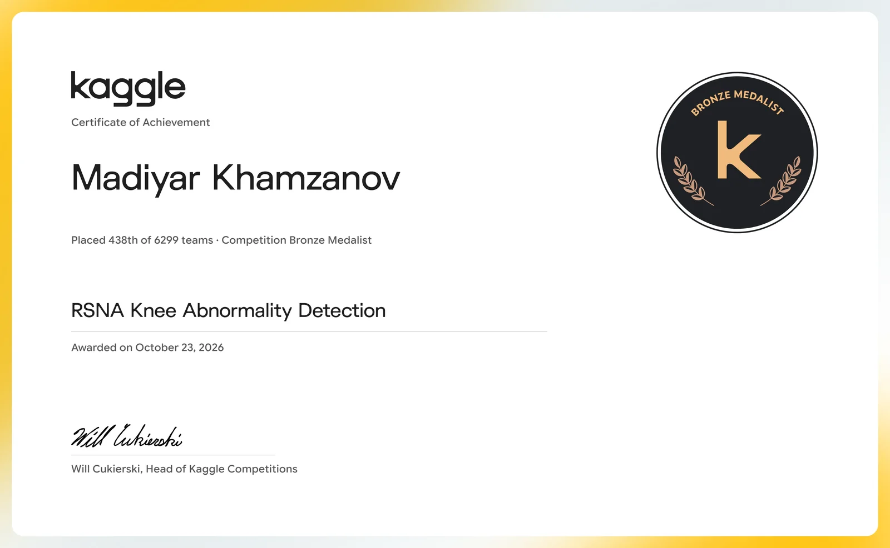
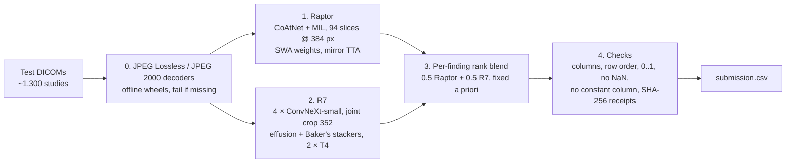

# RSNA Knee Abnormality Detection (Kaggle, 2026) — bronze, 438 / 6 299

| | |
|---|---|
| Competition | [RSNA Knee Abnormality Detection](https://www.kaggle.com/competitions/rsna-knee-abnormality-detection) — 30 Jul – 22 Oct 2026, $77,000 |
| Task | 12 findings per knee MRI study (ACL, MCL, both menisci, OA in 3 compartments, effusion, synovitis, Baker's cyst, contusion, fracture) |
| Metric | Mean ROC AUC over the 12 findings |
| Result | **438th of 6,299 teams, bronze medal** · private 0.943 · public 0.958 ([certificate](https://www.kaggle.com/certification/competitions/mkhamzanov/rsna-knee-abnormality-detection)) |
| Notebook | [`notebook/rsna-b1-ctrl.ipynb`](notebook/rsna-b1-ctrl.ipynb) · [on Kaggle](https://www.kaggle.com/code/mkhamzanov/rsna-b1-ctrl) |
| Write-up (RU/EN/KK) | [mkhamzanov.com/blog/kaggle-rsna-knee-bronze](https://www.mkhamzanov.com/blog/kaggle-rsna-knee-bronze) |

## Credits first

I did not train these models. The solution is an assembly of public community work, which the
competition rules explicitly allow ("freely & publicly available external data is allowed, including
pre-trained models"). My part is the pipeline around it: offline JPEG decoders for every stage,
hash checks, fail-closed behaviour and output validation, so the notebook runs reliably in the 9-hour
hidden-test budget.

| Piece | What | Author |
|---|---|---|
| Base notebook | Raptor + R7 pipeline, per-finding rank blend 0.5 / 0.5 | [heliosli](https://www.kaggle.com/code/heliosli/0-957-latest-dataset-score-in-one-click) |
| Raptor recipe | CoAtNet + multiple-instance-learning inference recipe and baseline weights | [dreaddevelopment](https://www.kaggle.com/datasets/dreaddevelopment/raptor-knee-widedense) |
| Raptor weights | All-data fine-tune with OAI, SWA checkpoint (`raptor_ft_alldata_t16_blendjev_oai_d96_r384_swa.pt`) | [nartaa](https://www.kaggle.com/datasets/nartaa/rsna-knee-publication-swa-weights-20261007) |
| R7 bundle | 4 × ConvNeXt-small (4 folds), joint crop 352, fastMRI auxiliary training, effusion and Baker's stackers | [heliosli](https://www.kaggle.com/datasets/heliosli/rsna-knee-compact-r7cnxfsss) |
| Weak labels | LLM-derived report labels | [stevenleehans](https://www.kaggle.com/datasets/stevenleehans/rsna-knee-llm-report-labels), [pilkwang](https://www.kaggle.com/datasets/pilkwang/rsna-knee-llm-labels), [riadmohamed42](https://www.kaggle.com/code/riadmohamed42/jev-knee-labels-verification) |
| Decoder wheels | Offline `pylibjpeg`, `pylibjpeg-libjpeg`, `pylibjpeg-openjpeg` (cp312) | [goodpjw2008](https://www.kaggle.com/datasets/goodpjw2008/rsna-knee-2-5d-convnext-reader) |

The Raptor checkpoint was trained with data from the Osteoarthritis Initiative (OAI), NIMH Data Archive,
dataset identifier 10.15154/0hcg-f676 — see the acknowledgement cell in the notebook.

## Pipeline

1. **Decoders.** The test set mixes uncompressed, JPEG Lossless and JPEG 2000 transfer syntaxes. The
   Kaggle image ships without `pylibjpeg` / `gdcm`, so compressed slices would be dropped silently.
   The first cell installs offline wheels into a target dir and exports it on `PYTHONPATH` for every
   stage subprocess; the notebook stops if they do not import.
2. **Raptor** runs as its own process so its GPU memory is released before stage 2. The checkpoint's
   SHA-256 is verified before inference; any failure stops the notebook (no silent single-model submit).
3. **R7** runs two workers on two T4s; `torch.compile` output is checked against eager (max |Δp| ≈ 0.0006).
4. **Blend.** AUC only cares about order, so each model's predictions are converted to per-finding
   percentile ranks over its own non-failed studies and averaged 50 / 50. Weights were fixed before any
   run and never tuned on the public leaderboard.
5. **Validation.** Same columns and row order as `sample_submission.csv`, finite values in [0, 1], no
   constant column; receipts with hashes and timings are written to `/kaggle/working`.

Runtime on the hidden test: ~6.3 h of the 9 h limit (2 × T4).

## Leaderboard context

| Zone | Ranks | Private score |
|---|---|---|
| 1st place (Team Kangaroo) | 1 | 0.960 |
| Gold | 1–22 | ≥ 0.954 |
| Silver | 23–314 | 0.943–0.954 |
| Bronze | 315–629 | 0.942–0.943 |
| **This notebook** | **438** | **0.943** |

1,297 teams finished on exactly 0.942 (mostly public notebooks); the bronze line ran through that wall.

## How the winners did it (worth reading)

- [1st place — Team Kangaroo](https://www.kaggle.com/competitions/rsna-knee-abnormality-detection/writeups/1st-place-solution): LLM agents (Codex, Claude Code) labelled every study from images + report, drew ROI and lesion boxes; ConvNeXt-T with box pooling.
- [5th place](https://www.kaggle.com/competitions/rsna-knee-abnormality-detection/discussion/752190): calibrated soft labels from three sources, bone-segmentation crops.
- [7th place](https://www.kaggle.com/competitions/rsna-knee-abnormality-detection/discussion/752217): one 2.5D architecture, no external data, GPT-6 reads of report + images.
- [235th place (silver)](https://www.kaggle.com/competitions/rsna-knee-abnormality-detection/discussion/751888): Chris Deotte's team with a Gemini agent as a teammate; frontier-LLM labelling benchmark.

## По-русски

Бронза, 438-е место из 6 299 команд. Решение собрано из открытых весов и кода сообщества (авторы — в
таблице выше), моя часть — сборка конвейера, декодеры, проверки и стабильный прогон в 9-часовом лимите.
Подробный разбор простыми словами: [mkhamzanov.com/blog/kaggle-rsna-knee-bronze](https://www.mkhamzanov.com/blog/kaggle-rsna-knee-bronze).
